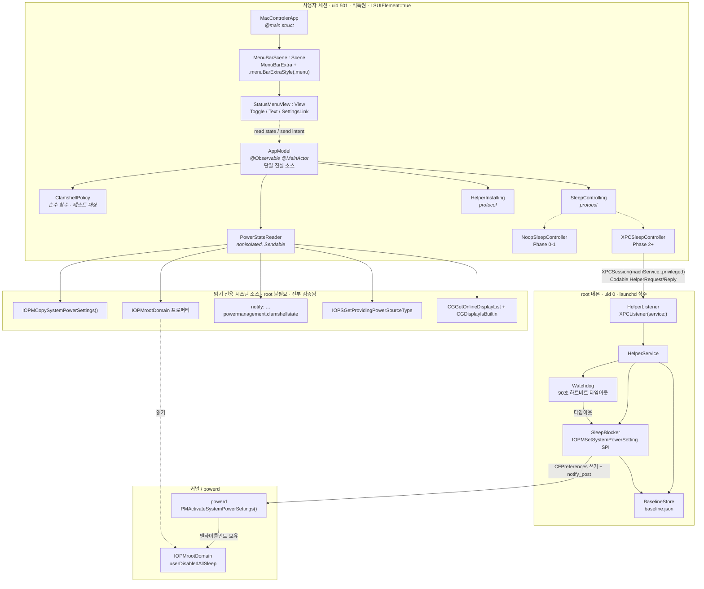
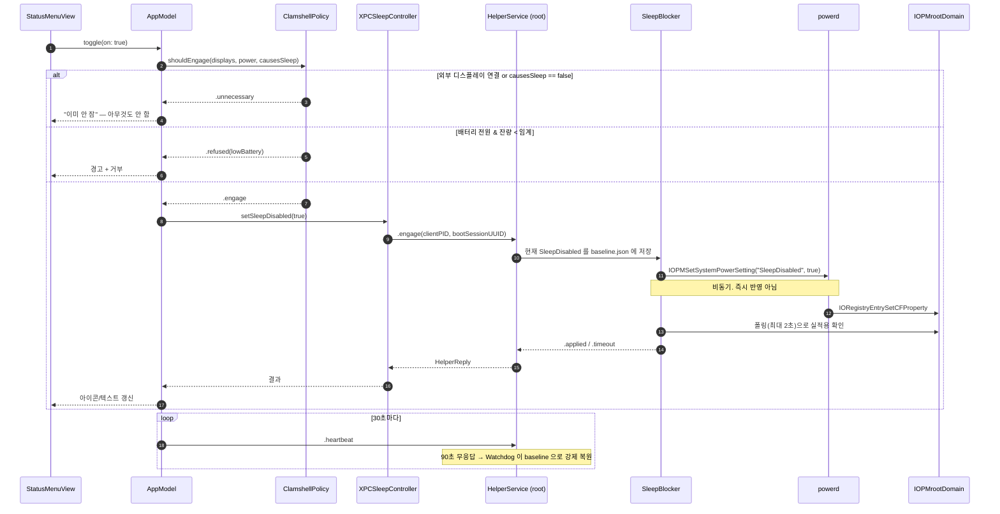

# mac-controler 설계

메뉴바에서 맥의 상태를 제어하는 앱. 1차 기능은 **클램쉘 모드(뚜껑 닫아도 안 자기) on/off**.

- 대상 환경: macOS 26.3.1 (Apple Silicon), Xcode 26.6, Swift 6.3.3
- 작성 기준: 로컬 SDK 헤더·man page·`ioreg`/`pmset` 실행 검증 + XNU/powerd 소스 대조

---

## 0. 요약

### 확정된 제품 결정 (2026-08-06)

| 질문 | 답 | 설계에 미치는 영향 |
|---|---|---|
| 배포 범위 | **내 맥에서만** | Phase 5 **미착수**. Apple Developer Program 미가입. 수동 LaunchDaemon 으로 영구 운영. 배포 타깃 macOS 26.0 확정 → `XPCPeerRequirement` 사용 가능. 총비용 0원 |
| 최종 스코프 | **슬립 제어만** (클램쉘 / 유휴 슬립 / 디스플레이 슬립 / 차단 프로세스 목록) | `MenuBarExtra(.menu)` 로 끝까지. 슬라이더 불필요 → NSStatusItem 전환은 P1 게이트 실패 시에만. 추가 root 권한·private 프레임워크 불필요 |
| 배터리 정책 | **경고 후 허용** | 배터리 전원에서 확인 다이얼로그 → 허용. 잔량 **15%** 자동 해제 + 알림. 시간 상한 기본 **4시간**, `SettingsView` 에서 30분~8시간·꺼짐 중 선택 |

미결 없음. (착수 전 정리 완료 — 아래 §1 참조)

### 기술 결정

| 항목 | 결정 |
|---|---|
| 언어/툴체인 | Swift 6.3, 언어모드 `.v6`, 배포 타깃 macOS 26.0 |
| UI | SwiftUI `MenuBarExtra` + `.menuBarExtraStyle(.menu)`, `LSUIElement=true` |
| 프로젝트 형태 | **SwiftPM 패키지 1개(멀티 타깃) + Makefile 로 `.app` 조립. `.xcodeproj` 없음** |
| 권한 상승 | 앱(비특권) + **root LaunchDaemon 헬퍼**(XPC). Phase 2~4 수동 설치 → Phase 5 `SMAppService` |
| 샌드박스 | **OFF** (권한 상승과 양립 불가 → Mac App Store 배포 영구 포기) |
| 테스트 | Swift Testing (`swift test`) — 순수 정책 로직 대상 |

---

## 1. 핵심 제약: 클램쉘은 root 없이는 불가능하다

이것이 설계 전체를 결정한다. `caffeinate` 래핑으로 끝날 줄 알았다면 오답이다.

### 커널이 뚜껑 닫힘 슬립을 판정하는 지점

XNU `IOPMrootDomain.cpp`:

```cpp
bool IOPMrootDomain::shouldSleepOnClamshellClosed(void) {
    if (!clamshellExists) return false;
    return !clamshellDisabled                    // 외부 디스플레이 연결 시 그래픽스가 끔
        && !(desktopMode && acAdaptorConnected)  // WindowServer 만 설정 가능
        && !clamshellSleepDisableMask;           // powerd 만 설정 가능
}
```

세 조건 모두 서드파티가 제어 불가. `desktopMode` 는 `kIOPMDisplayServiceEntitlement` 보유 WindowServer 전용,
`clamshellSleepDisableMask` 는 powerd 가 `IOConnectCallMethod(kPMSetClamshellSleepState)` 로만 설정.

### 유일한 레버 — `SleepDisabled`

```cpp
bool IOPMrootDomain::checkSystemSleepAllowed(...) {
    do {
        if (gSleepDisabledFlag)   { err = kPMConfigPreventSystemSleep; break; }
        if (userDisabledAllSleep) { err = kPMUserDisabledAllSleep;     break; }  // ← 이것
        ...
```

`userDisabledAllSleep`(= `SleepDisabled` 프로퍼티)은 do-블록 **두 번째**에서 검사되므로
idle sleep 뿐 아니라 뚜껑 닫힘(demand sleep)까지 전부 차단한다.
이것이 "왜 `disablesleep` 만이 클램쉘을 커버하는가"의 근본 이유다.

### 닫혀 있는 대안 경로 (재논의 차단용)

| 경로 | 판정 | 근거 |
|---|---|---|
| 공개 `IOPMAssertion` 전부 | **불가** | SDK 26.5 `IOPMLib.h`: *"The system may still sleep for **lid close**, Apple menu, low battery"* |
| `kIOPMAssertionTypePreventSystemSleep` | **불가** | 동 헤더: *"Deprecated in 10.9 … not supported in any OS X releases"* |
| `caffeinate` (-d/-i/-m/-s/-u) | **불가** | 5개 assertion 만 생성. `man caffeinate` 에 lid/clamshell 언급 0회 |
| `kIOPMAssertionAppliesOnLidClose` | **불가** | powerd 가 `com.apple.private.iokit.assertonlidclose` 엔타이틀먼트 검사 후 거부 |
| `IORegistryEntrySetCFProperty(rootDomain, "SleepDisabled", …)` | **불가** (root 여도) | `com.apple.private.iokit.rootdomain-set-property` 필요 |
| `pmset clamshell 0/1` | **불가** | `IOPMTestClamshellClose/Open` 은 XNU `#if DEBUG \|\| DEVELOPMENT` 전용 |

### 유효한 쓰기 경로 (root 필수)

```
IOPMSetSystemPowerSetting(CFSTR("SleepDisabled"), kCFBooleanTrue)   ← SPI
  │  (getuid()!=0 && geteuid()!=0) → 즉시 kIOReturnNotPrivileged
  ├─→ CFPreferencesSetValue("SystemPowerSettings", …, "com.apple.PowerManagement", AnyUser/CurrentHost)
  └─→ notify_post("com.apple.system.powermanagement.prefschange")
         └─→ powerd: PMActivateSystemPowerSettings()
                └─→ IORegistryEntrySetCFProperty(rootdomain, "SleepDisabled", …)   ← 엔타이틀먼트 보유
                       └─→ 커널 userDisabledAllSleep 갱신
```

> **Phase 2 착수 시 실증 완료 (2026-08-06).** 두 SPI 심볼이 `MacOSX26.5.sdk` 의
> `IOKit.tbd` 에 실재하고(`_IOPMSetSystemPowerSetting`, `_IOPMCopySystemPowerSettings`),
> `@_silgen_name` 으로 정상 링크된다. 비특권 앱에서 실행한 결과:
> - `IOPMCopySystemPowerSettings()` → `SleepDisabled=false` 정상 반환 (**root 불필요**)
> - `IOPMSetSystemPowerSetting()` → **`0xE00002C1` = `kIOReturnNotPrivileged`**, 시스템 값 불변
>
> "쓰기에 root 가 필요하다"는 것은 문서상 주장이 아니라 이 맥에서 확인된 사실이다.
> 앱(비특권) + 헬퍼(root) 2-프로세스 구조는 선택이 아니라 강제다.

헬퍼는 커널을 직접 건드리지 않는다. 디스크에 희망값을 쓰고 powerd 를 깨울 뿐이다.
→ **반영이 비동기다.** 설정 직후 `ioreg` 는 옛 값일 수 있으므로 폴링(초기값 2초, Phase 2 에서 실측 확정)으로 사후 확인 필수.

### 읽기 경로 (root 불필요 — 전부 실행 검증됨)

| 값 | 수단 |
|---|---|
| `SleepDisabled` 희망값 | `IOPMCopySystemPowerSettings()` (비root 성공 확인) |
| `SleepDisabled` 실적용값 / `AppleClamshellState` / `AppleClamshellCausesSleep` / `BootSessionUUID` | `IOPMrootDomain` 프로퍼티 |
| 뚜껑 상태 변화 이벤트 | notify 키 `com.apple.system.powermanagement.clamshellstate` (1=닫힘) |
| 전원 소스 / 배터리 | `IOPSGetProvidingPowerSourceType` + `IOPSNotificationCreateRunLoopSource` |
| 외부 디스플레이 | `CGGetOnlineDisplayList` + `CGDisplayIsBuiltin` + `CGDisplayRegisterReconfigurationCallback` |

**이 맥의 baseline (2026-08-06, 착수 전 정리 완료):**

```
"SleepDisabled"             = No     ← 정리 완료. 개발 baseline
"AppleClamshellCausesSleep" = Yes
"AppleClamshellState"       = No
```

> 조사 시점에는 `SleepDisabled = Yes` 였다(주체 불명). `sudo pmset disablesleep 0` 으로 정리했다.
> Phase 2 의 검수 기준(`ioreg` 값이 No↔Yes 로 바뀌는가)이 성립하려면 baseline 이 `No` 여야 한다.
> 다만 **코드는 baseline 이 `Yes` 인 경우도 견뎌야 한다** — 항상 현재 값을 읽어 저장하고 그 값으로만 복원한다(§7).

`SleepDisabled` 와 `AppleClamshellCausesSleep` 은 **독립**이다. 따라서 UI 판정은 OR 조건:

```swift
var isAwakeOnLidClose: Bool { !clamshellCausesSleep || sleepDisabled }
```

`AppleClamshellCausesSleep` 만 보고 판단하면 오답.

### 명령줄 등가물의 함정 (앱은 SPI 직접 호출)

```bash
sudo pmset disablesleep 1      # -a/-b/-c 는 no-op (system-wide 설정이라 전원소스 무관)
pmset -g | head -2             # System-wide power settings 블록에만 표시
ioreg -r -k SleepDisabled -d 1 # -r 필수
```

- `disablesleep` 은 `man pmset` 에 **없는 비문서 옵션**
- `pmset -g custom` 에는 `SleepDisabled` 가 안 나옴
- 비root 실행 시 `must be run as root` 를 찍지만 **종료코드는 0** → 셸아웃하면 실패를 놓친다

---

## 2. 기술스택 결정

### 언어 / 툴체인 — Swift 6.3, macOS 26.0 타깃

이미 설치되어 리드타임 0. SDK 는 MacOSX26.5 하나뿐이라 하위 SDK 자체가 없다.
타깃 26.0 이면 `XPCPeerRequirement.isFromSameTeam(...)`(macOS 26 신규)로 헬퍼 클라이언트 검증이 한 줄.

*나중에 14.0 으로 낮추는 비용*: audit token + SecCode 기반 수동 피어 검증 ~60줄, Settings 씬 availability 분기. 둘 다 국소적.

### UI — SwiftUI `MenuBarExtra` + `.menu` 스타일

`.menu` 는 실제 NSMenu 로 렌더되어 `Toggle` 이 체크마크 항목에 그대로 매핑되고 위치·키보드 탐색을 시스템이 처리한다.
`.window` 스타일의 최대 결함(팝오버를 프로그램적으로 닫을 수 없음 — FB11984872, 2023년 제출 후 SDK 26.5 까지 Open)을 구조적으로 회피.

`MenuBarExtra(.menu) + Toggle + SettingsLink + SMAppService` 조합이 macOS 26 SDK 에서 `swiftc -typecheck` 무오류 확인됨.

**NSStatusItem 으로 이관해야 하는 트리거 (미리 못박음):**
1. 좌/우클릭 분기가 필요할 때
2. 팝오버 표시 상태를 프로그램적으로 제어해야 할 때
3. 슬라이더·차트 같은 임의 레이아웃이 필요할 때

이관 비용 40~80줄 (콘텐츠 SwiftUI 뷰는 `NSHostingController` 로 무수정 재사용).

### 상태 갱신 — push 전용

`.menu` 스타일에는 **메뉴 열림 이벤트가 없다.** macOS 26.5 SDK 전수 조사 결과 `MenuBarExtra` 공개 심볼은
base init 2개 + Text/Label 편의 init + `menuBarExtraStyle(_:)` 이 전부. `isPresented`/`onOpen` 부재.
콘텐츠 뷰의 `.onAppear` 도 열릴 때 호출되지 않음(FB13683950). → pull 설계는 성립하지 않는다.

또 App 구조체의 `@State` 변화가 콘텐츠에 반영되지 않는 별도 버그(Apple 포럼 720625)가 있어
**Scene / View 분리 + `@Observable` 인스턴스 명시 주입**이 필수다.

> 참고: "메뉴가 런루프를 블록한다"는 흔한 설명은 부정확하다. NSMenu 는 `NSEventTrackingRunLoopMode` 중첩 트래킹 루프로 모드를 바꿀 뿐이다. 문제는 SwiftUI 가 열림 훅을 노출하지 않는 것.

### 프로젝트 형태 — SwiftPM + Makefile, `.xcodeproj` 없음

터미널 중심 개발에 최적. 소스/타깃/의존성이 전부 `Package.swift` 텍스트에 있어 diff 친화적이고 pbxproj 충돌이 없다.

SPM 이 `.app` product 를 못 만드는 건 사실이지만(Product 타입은 library/executable/plugin 3종),
그 공백은 `mkdir Contents/{MacOS,Resources}` + `cp` + `codesign -s -` = Makefile 15줄로 메워진다.
SF Symbols 만 쓰면 에셋 카탈로그(actool)도 불필요.

XcodeGen/Tuist 는 이 머신에 미설치 — 외부 툴체인 의존만 추가. 1인 프로젝트에 실익 없음.

### 탈락한 대안

| 대안 | 탈락 이유 |
|---|---|
| Electron | 상주 유틸이 Chromium 을 물 이유 없음. 참고 실측: Claude.app 753MB/14프로세스 vs Hidden Bar.app 23MB |
| Tauri / Go | IOKit SPI·XPC·ServiceManagement 를 전부 FFI 로 감싸야 함. 이득 0 |
| Python + rumps | 헬퍼 데몬·코드서명·XPC 스토리가 없음 |
| NSStatusItem 직행 | 토글 하나에는 과설계. 이관 트리거 도달 시 옮긴다 |

---

## 3. 권한 상승 — 갈아끼우기 쉬운 구조

권한 경로를 **읽기/쓰기로 분리**하고, 쓰기만 프로토콜 뒤로 숨긴다.

```
읽기 (root 불필요, 영구 고정)  →  앱 본체가 직접
쓰기 (root 필요, 3번 갈아끼움) →  protocol SleepControlling
                                  ├─ Phase 0~1: NoopSleepController   (UI 만 검증)
                                  ├─ Phase 2~4: XPCSleepController + 수동 LaunchDaemon (서명 불필요)
                                  └─ Phase 5+ : XPCSleepController + SMAppService      (서명/공증 필요)
```

**Phase 2 와 Phase 5 는 헬퍼 바이너리와 XPC 프로토콜이 100% 동일하다.**
바뀌는 것은 "그 바이너리를 어디에 두고 누가 launchd 에 등록하느냐"뿐.

| | Phase 2 (수동 LaunchDaemon) | Phase 5 (SMAppService) |
|---|---|---|
| 헬퍼 소스 / XPC 프로토콜 | `Sources/MacControlerHelper`, `Sources/HelperProtocol` | **동일** |
| 헬퍼 위치 | `/Library/PrivilegedHelperTools/` | `App.app/Contents/MacOS/` |
| plist 위치 | `/Library/LaunchDaemons/` | `App.app/Contents/Library/LaunchDaemons/` (`BundleProgram`) |
| 설치 | `sudo make install-helper` (1회) | `SMAppService.daemon(plistName:).register()` |
| 코드서명 | **불필요** | Developer ID + hardened runtime + notarize |
| 사용자 승인 | 없음 | 시스템 설정 > 로그인 항목 |
| 앱 코드 변경 | — | `HelperInstaller` 파일 1개 교체 (~80줄) |

**Phase 2 경로가 유효한 근거는 SDK 헤더 자체다** — `SMAppService.h`:

> *"Legacy LaunchDaemons installed in /Library/LaunchDaemons will continue to be bootstrapped without explicit approval in System Settings since writing to /Library is protected with filesystem permissions."*

Apple 이 macOS 26 SDK 에서 이 경로의 유효성을 명시 보증하고, **코드서명을 요구하지 않는다**
(보안 경계가 서명이 아니라 파일시스템 권한이므로).

이 맥에는 유효한 서명 신원이 **0개**다 (`security find-identity -v -p codesigning` → `0 valid identities found`).
Phase 1 에서 SMAppService 를 primary 로 잡으면 첫 커밋 전에 $99 결제부터 해야 한다.

### `sudoers.d` 를 쓰지 않는 이유

선행 사례 다수(Clapet, nosleep, StayAwake)가 `/etc/sudoers.d` + `NOPASSWD: /usr/bin/pmset` 를 쓴다. 가장 싸지만 채택하지 않는다:

- 시스템 전역 정책을 앱이 오염. 인자 제한을 잘못 쓰면 LPE 표면 (`man sudoers` 가 와일드카드의 공백 가로지르기를 경고)
- 파일명에 점(`.`)이 들어가면 sudo 가 **경고 없이 조용히 무시** — `com.example.foo` 같은 역DNS 이름이 안 먹는 함정
- **결정타: 하트비트 워치독을 구현할 수 없다.** 상주 데몬 없이는 앱 크래시 시 방전 사고를 막을 방법이 없다
- Phase 5 로 갈 때 코드가 전부 폐기된다

### 기타 탈락

- `SMJobBless`: `__OSX_DEPRECATED(10.6, 13.0, "Please use SMAppService instead")`
- `AuthorizationExecuteWithPrivileges`: 10.7부터 deprecated(15년), 매 호출 프롬프트, 재사용 자산 0
- setuid 바이너리: 앱 번들은 SIP 밖이라 교체 가능. dmg/zip 배포 시 setuid 비트 유실
- **App Sandbox: OFF 로 확정.** 샌드박스는 권한 상승 자체를 금지. Apple DTS 조합표상 '샌드박스 앱 + 비샌드박스 job' 은 macOS 14.2+ 에서 차단. → MAS 배포 영구 포기 (Amphetamine 이 정확히 이 이유로 비샌드박스 보조앱을 따로 배포)

---

## 4. 아키텍처

권한 경계가 곧 프로세스 경계다. **읽기는 전부 비특권 앱이, 쓰기만 root 헬퍼가.**



### 쓰기 흐름 (토글 ON)



### 동시성 규칙

| 모듈 | 격리 | 이유 |
|---|---|---|
| `ClamshellCore` | `nonisolated` + `Sendable` | 앱·헬퍼 양쪽에서 사용. MainActor 강제하면 헬퍼에서 못 씀 |
| `HelperProtocol` | `Sendable` `Codable` 만 | 공유 계약. IOKit/AppKit import 금지 |
| `MacControlerApp` | `.defaultIsolation(MainActor.self)` | UI 전체 기본 MainActor → 어노테이션 노이즈 제거 |
| `MacControlerHelper` | `nonisolated` 기본 | AppKit 없음 |

IOKit 의 `@convention(c)` 콜백은 컨텍스트를 캡처할 수 없으므로 `refcon` 에 `Unmanaged` 포인터를 넘기고,
UI 갱신은 `Task { @MainActor in ... }` 트램폴린으로 홉한다. Swift 6 모드 컴파일 검증됨.

---

## 5. 프로젝트 구조

```
mac-controler/
├── Package.swift                  # 유일한 프로젝트 정의
├── Makefile                       # 번들 조립 / 실행 / 헬퍼 설치·제거
│
├── Sources/
│   ├── ClamshellCore/             # root 불필요. 앱·헬퍼 공유. swift test 대상
│   │   ├── PowerSnapshot.swift        # Sendable struct
│   │   ├── PowerStateReading.swift    # protocol (Fake 주입용)
│   │   ├── IOKitPowerStateReader.swift
│   │   ├── ClamshellPolicy.swift      # ★ 순수 함수. 테스트의 90%
│   │   ├── SleepControlling.swift     # protocol
│   │   ├── NoopSleepController.swift  # Phase 0-1
│   │   └── IOKitSPI.swift             # ★ SPI 선언 격리 지점
│   │
│   ├── HelperProtocol/            # XPC 계약. 의존성 0
│   │   ├── HelperRequest.swift        # .engage / .release / .heartbeat / .status
│   │   ├── HelperReply.swift          # .applied / .alreadyBaseline / .timeout / .denied
│   │   └── HelperConstants.swift
│   │
│   ├── MacControlerApp/           # 메뉴바 앱
│   │   ├── MacControlerApp.swift      # @main
│   │   ├── MenuBarScene.swift         # ★ Scene 분리 (갱신 버그 회피)
│   │   ├── StatusMenuView.swift       # ★ View 분리. 모델 명시 주입
│   │   ├── SettingsView.swift
│   │   ├── AppModel.swift             # @Observable @MainActor
│   │   ├── XPCSleepController.swift
│   │   ├── HelperInstalling.swift     # protocol
│   │   └── ManualDaemonInstaller.swift# P5 에 SMAppServiceInstaller 추가
│   │
│   └── MacControlerHelper/        # root 데몬
│       ├── main.swift                 # 리스너 부팅 + 부팅세션 고아 복구
│       ├── HelperService.swift
│       ├── SleepBlocker.swift         # ★ SPI 호출 유일 지점
│       ├── Watchdog.swift
│       └── BaselineStore.swift
│
├── Tests/ClamshellCoreTests/
│   ├── ClamshellPolicyTests.swift # Swift Testing
│   └── FakePowerStateReader.swift
│
├── Resources/
│   ├── App-Info.plist             # LSUIElement=true, LSMinimumSystemVersion=26.0
│   ├── helper-launchd.plist
│   └── App.entitlements           # 샌드박스 OFF
│
└── Scripts/
    ├── bundle.sh / install-helper.sh / uninstall-helper.sh / verify.sh
```

### Package.swift 골자

```swift
// swift-tools-version: 6.2
import PackageDescription

let package = Package(
    name: "MacControler",
    platforms: [.macOS(.v26)],
    targets: [
        .target(name: "HelperProtocol",
                swiftSettings: [.swiftLanguageMode(.v6)]),

        .target(name: "ClamshellCore",
                dependencies: ["HelperProtocol"],
                swiftSettings: [.swiftLanguageMode(.v6)]),   // defaultIsolation 미설정

        .executableTarget(name: "MacControlerApp",
                dependencies: ["ClamshellCore", "HelperProtocol"],
                swiftSettings: [.swiftLanguageMode(.v6),
                                .defaultIsolation(MainActor.self)]),

        .executableTarget(name: "MacControlerHelper",
                dependencies: ["ClamshellCore", "HelperProtocol"],
                swiftSettings: [.swiftLanguageMode(.v6)]),

        .testTarget(name: "ClamshellCoreTests", dependencies: ["ClamshellCore"]),
    ]
)
```

### IOKitSPI.swift — 비문서 인터페이스 격리

전체 프로젝트에서 SPI 를 언급하는 유일한 파일. macOS 업데이트로 깨지면 여기만 본다.

```swift
import IOKit

// 공개 SDK 헤더에 선언 없음 (IOPMLibPrivate.h 소속 SPI).
// IOKit.tbd 에 export 되어 있어 링크는 정상. pmset 자신도 이 심볼을 import 한다.
@_silgen_name("IOPMSetSystemPowerSetting")
func _IOPMSetSystemPowerSetting(_ key: CFString, _ value: CFTypeRef) -> IOReturn

@_silgen_name("IOPMCopySystemPowerSettings")
func _IOPMCopySystemPowerSettings() -> Unmanaged<CFDictionary>?

// IOPMLibPrivate.h: #define kIOPMSleepDisabledKey CFSTR("SleepDisabled")
let kSleepDisabledKey = "SleepDisabled" as CFString
```

### Makefile 타깃

| 명령 | 동작 | 권한 |
|---|---|---|
| `make test` | `swift test` — 순수 로직 | 없음 |
| `make app` | `swift build -c release` + `bundle.sh` → `dist/MacControler.app` (ad-hoc 서명) | 없음 |
| `make run` | `make app` 후 `open dist/MacControler.app` | 없음 |
| `make install-helper` | 헬퍼 + plist 설치 + `launchctl bootstrap system` | **sudo 1회** |
| `make reinstall-helper` | `bootout` → 재설치 → `bootstrap` (개발 루프 필수) | **sudo** |
| `make uninstall-helper` | SleepDisabled 원복 → `bootout` → 파일 제거 | **sudo** |
| `make logs` | `/usr/bin/log stream --predicate 'subsystem == "…"'` | 없음 |
| `make verify` | `ioreg -r -k SleepDisabled -d 1` | 없음 |

> **함정**: zsh 에서 `log` 는 셸 빌트인이라 `log stream …` 이 `too many arguments` 로 깨진다(실측 확인). **반드시 `/usr/bin/log` 절대경로.**

### 설치 경로 (실측 확인 완료)

| 대상 | Phase 2 경로 | 소유/모드 |
|---|---|---|
| 헬퍼 실행파일 | `/Library/PrivilegedHelperTools/<id>.helper` | `root:wheel 0755` |
| launchd plist | `/Library/LaunchDaemons/<id>.helper.plist` | `root:wheel 0644` |
| baseline 상태 | `/Library/Application Support/<id>/baseline.json` | `root:wheel 0644` |

- `/Library/PrivilegedHelperTools` 는 이 맥에 실재 (`drwxr-xr-t root wheel`)
- `/usr/local/libexec` 는 이 맥에 **존재하지 않고**, `/usr/local` 은 admin 쓰기 가능이라 부적절
- `install(1)` 로 원자적 배치. `chmod -R 777` 류 절대 금지 (iStat Menus LPE 원인)
- 개발용/배포용 번들 ID 를 **분리**할 것 — macOS 26 SMAppService XPC 연결 실패 회귀(Apple 포럼 813148)의 DTS 권고 완화책

---

## 6. 로드맵

### Phase 0 — 껍데기 (반나절)
메뉴바에 아이콘이 뜬다. 빌드·실행 루프 확립.

**산출물**: `Package.swift`, `Makefile`, `bundle.sh`, `App-Info.plist`(LSUIElement), Scene/View 3파일. ad-hoc 서명.

**완료조건**: `make run` → 메뉴바 우측에 SF Symbol 표시, 클릭 시 네이티브 메뉴, "종료" 동작, **Dock 아이콘 없음**, ⌘Tab 에도 없음.

### Phase 1 — 읽기 전용 상태판 (1~2일)
root 없이 얻을 수 있는 모든 상태를 실시간 표시. 시스템은 전혀 건드리지 않는다.

**산출물**: `ClamshellCore` 전체, `AppModel`, `NoopSleepController`, 테스트. notify/IOPS/CGDisplay 구독.

**완료조건**:
1. 메뉴에 5개 값 표시 — 뚜껑 상태, SleepDisabled 실적용값, AppleClamshellCausesSleep, 전원+배터리%, 외부 디스플레이 수
2. 전원 어댑터 뽑았다 꽂으면 **폴링 없이** 즉시 갱신
3. `swift test` 통과 — 특히 `isAwakeOnLidClose` 4가지 조합
4. **★ 게이트: 상태값이 실제로 메뉴에 갱신되어 보이는가?** 안 되면(포럼 720625 버그가 macOS 26 에서 재현) 즉시 NSStatusItem+NSMenu 로 전환 (40~80줄, 콘텐츠 뷰는 NSHostingView 재사용)

### Phase 2 — root 헬퍼와 첫 토글 (2~3일)
메뉴 토글로 실제 SleepDisabled 가 바뀐다. 비밀번호는 설치 때 딱 한 번.

**산출물**: `HelperProtocol`, `MacControlerHelper`, `helper-launchd.plist`, install/uninstall 스크립트, `XPCSleepController`, `ManualDaemonInstaller`.

**완료조건**:
1. `sudo make install-helper` 1회 후 재부팅 없이 헬퍼 기동 (`sudo launchctl print system/<label>`)
2. 토글 ON → `make verify` 가 `Yes`. OFF → 원래 값 복귀
3. 토글 시 **비밀번호 프롬프트 없음**
4. `/usr/bin/log stream` 에 헬퍼 로그

> **첫 30분 체크포인트**: `XPCListener(service:)` 가 launchd MachServices 에 바인딩 안 되면 즉시 `NSXPCListener(machServiceName:)` 로 전환(~1시간). Stats/Lidless/AlDente 가 쓰는 검증된 경로.

### Phase 3 — 안전장치 (생략 불가) (2~3일)
앱이 죽어도, 재부팅해도, 배터리가 떨어져도 맥이 영영 안 자는 상태로 남지 않는다.

**산출물**: `BaselineStore`, `Watchdog`(90초), 부팅 세션 고아 감지, `ClamshellPolicy.decide`, 아이콘 상태 구분, 절대 타임아웃(기본 4시간).

**완료조건**:
1. 토글 ON 상태에서 `kill -9 <앱PID>` → **90초 이내** SleepDisabled 원복
2. 토글 ON 상태로 재부팅 → BootSessionUUID 불일치 감지해 부팅 직후 자동 원복
3. 배터리 + 잔량 15% 미만에서 ON 시도 → 거부 + 경고
4. 외부 디스플레이 연결 상태에서 ON → "이미 안 잠" 표시, SleepDisabled 를 **건드리지 않음**
5. `make uninstall-helper` 후 `pmset -g` 가 원래 값

### Phase 4 — 실기 클램쉘 검증 + 마감 (1~2일)
실제로 뚜껑을 닫고 살아있는지 확인. 개인 사용 완성.

**산출물**: 실기 체크리스트 실행·문서화, `SettingsView`, 로그인 항목 등록, 진단 메뉴(`IOPMCopyAssertionsByProcess` — root 불필요).

**완료조건**:
1. 전원 연결 + 외부 디스플레이 없이 ON → 뚜껑 닫고 5분 후 다른 기기에서 ssh/화면공유 접속 성공
2. **관찰 기록**: 내장 디스플레이 꺼짐 여부, Wi-Fi 유지 여부, DarkWake 진입 여부 — 소스상 추정만 있고 실측 미검증이므로 반드시 눈으로 확인해 문서화
3. 토글 OFF 후 뚜껑 닫으면 정상적으로 잠
4. `SMAppService.mainApp.status == .enabled`

### Phase 5 — 배포 전환 — **미착수 확정** (2~4일 + 공증 대기)

> 배포 범위를 **개인 전용**으로 확정했으므로 이 Phase 는 실행하지 않는다.
> Phase 4 에서 앱은 완성되며, 아래는 나중에 마음이 바뀔 경우를 위한 기록이다.
> 전환 비용은 `HelperInstaller` 파일 1개(~80줄) + 서명 파이프라인이 전부라 미루는 데 페널티가 없다.

**산출물**: Apple Developer Program 가입 + Developer ID 인증서, `SMAppServiceInstaller`, 헬퍼/plist 번들 내부 이동(`BundleProgram`, `AssociatedBundleIdentifiers`), `XPCPeerRequirement.isFromSameTeam`, inside-out `codesign --options runtime` → `notarytool submit` → `stapler`, 승인 UX, 레거시 헬퍼 감지·제거.

**완료조건**: 클린 맥에서 dmg → 드래그 → 승인 → 토글 동작. `spctl -a -vv` → `accepted, source=Notarized Developer ID`. 앱·헬퍼 양쪽 `flags=0x10000(runtime)`.

---

## 7. 리스크

| 심각도 | 리스크 | 완화 |
|---|---|---|
| **치명** | **되돌리기 실패** — SleepDisabled 는 `/Library/Preferences/com.apple.PowerManagement.plist` 에 영구 저장되고 powerd 가 부팅 시 재적용. 크래시·강제종료·로그아웃·재부팅 어디서도 자동 원복 안 됨 | ① baseline 스냅샷 후 그 값으로만 복원 ② 하트비트 90초 워치독(**sudoers 안을 탈락시킨 결정적 이유**) ③ BootSessionUUID 불일치 감지 ④ uninstall 이 파일 제거 전 반드시 원복 ⑤ engaged 상태 아이콘 시각 구분.<br>**Phase 2 에서 ①②③ 을 자동 테스트로 고정** (`HelperCoreTests`, 13개): 남이 켜둔 값을 release 해도 유지 / 하트비트 끊기면 원복 / 재부팅 세션 불일치 시 기동 즉시 원복 / 같은 세션 재시작은 워치독에 위임 / 쓰기 실패 시 baseline 미잔류 |
| **치명** | **배터리 방전 사고** — 커널에서 `userDisabledAllSleep` 이 `lowBatteryCondition` 보다 먼저 검사되어 긴급 슬립이 차단될 수 있음. 뚜껑 닫힌 채 가방 속 완전 방전 → 미저장 작업 손실 | 소스 근거는 있으나 실기 미검증(파괴적 테스트라 미실행) → 앱이 직접 방어: 배터리 전원 engage 경고/거부, 잔량 15% 자동 원복 + 알림, 절대 타임아웃 4시간, 뚜껑닫힘+고발열 시 강제 해제 |
| 높음 | root XPC 리스너가 LPE 통로가 됨 | **개인 전용 확정 + 서명 신원 0개 → 팀 ID 가 없어 암호학적 피어 검증이 원리적으로 불가.** 이 상태가 영구적이므로 완화책도 영구다: ① 엔드포인트를 `setSleepDisabled`/`heartbeat`/`status` 3개로 최소화 ② 정책 판단은 전부 비특권 앱 쪽에 두고 헬퍼는 '값 하나 설정'만 ③ 헬퍼 파일/디렉터리 권한 절대 미완화 ④ **이 맥 외부로 배포하지 않음이 전제** — 배포하려면 Phase 5(서명+`XPCPeerRequirement.isFromSameTeam`)가 선행되어야 한다 |
| 높음 | **비문서 인터페이스 의존** — `disablesleep` 은 man 에 없고 `IOPMSetSystemPowerSetting` 은 공개 헤더에 선언 없음 | SPI 선언을 `IOKitSPI.swift` 한 파일에, 호출을 `SleepBlocker.swift` 한 곳에 격리. `IOReturn == success` 를 신뢰하지 말고 **항상 ioreg 로 사후 검증**. 실패를 정상 시나리오로 처리. UI 에 '비공식 시스템 설정 변경' 고지 |
| 중간 | root 만 있으면 `IORegistryEntrySetCFProperty` 로 직접 쓸 수 있다는 오해 | 엔타이틀먼트가 없으면 root 여도 `kIOReturnNotPermitted`. 반드시 prefs+powerd 간접 경로. **비동기**이므로 폴링으로 감쌈. 근거를 XNU 인용과 함께 코드 주석에 남겨 재논의 차단 |
| ~~중간~~ → **해소** | ~~MenuBarExtra 콘텐츠 미갱신 버그(포럼 720625)~~ | **Phase 1 에서 실측 — macOS 26.3.1 에서 재현되지 않는다.** `caffeinate` 로 슬립 차단 프로세스를 늘린 뒤 갱신하자 메뉴 항목이 `슬립 막는 프로세스 3개` → `4개` 로 바뀌는 것을 접근성 API 로 확인. Scene/View 분리 + `@Observable` 명시 주입 구조는 유지하되 **NSStatusItem 전환은 불필요** |
| 중간 | SMAppService 개발 루프 함정 — plist/헬퍼가 바뀌면 재등록해야 반영 | Phase 2 부터 `make reinstall-helper` 를 만들어 개발 루프 인터페이스를 미리 고정 |
| 중간 | macOS 26 SMAppService LaunchDaemon XPC 연결 실패 회귀 (포럼 813148, 소수 머신, 공식 수정 없음) | **Phase 5 한정.** Phase 2~4 수동 경로는 영향 없음(수동을 먼저 택하는 부수적 이점). 개발/배포 번들 ID 분리 + 재등록 폴백 UI |
| 중간 | 다른 도구/사용자가 켜둔 `SleepDisabled` 를 앱이 덮어써 기존 환경을 파괴 | ~~이 맥은 조사 시점에 `SleepDisabled=1` 이었다~~ → 착수 전 `0` 으로 정리 완료. **그래도 코드는 이 케이스를 견뎌야 한다**: 최초 실행 시 현재 값을 baseline 으로 저장하고, engage 하지 않은 동안 절대 변경하지 않는다. baseline 이 `Yes` 면 '이 앱이 켠 것이 아님' 을 UI 에 표시 |
| 낮음 | 뚜껑 닫힘을 소프트웨어로 시뮬레이션 불가 (`IOPMTestClamshellClose` 는 DEBUG 커널 전용) | 자동 테스트를 정책 로직·상태 파싱·토글 왕복까지로 한정. 실제 뚜껑은 Phase 4 수동 체크리스트 + 결과 문서화 |
| 낮음 | Intel 맥 미검증 — powerd 의 clamshellstate notify 가 `#if TARGET_CPU_ARM64` 분기 | 당분간 Apple Silicon 전용 명시. 필요 시 `IONotificationPort` + `kIOPMMessageClamshellStateChange` 폴백 (`PowerStateReading` 뒤라 구현 추가만으로 대응) |

### UI 카피에 반드시 명시할 것

> **이 스위치는 핀포인트가 아니라 시스템 전역 슬립 킬스위치다.**
> 뚜껑 닫힘뿐 아니라 idle sleep, Apple 메뉴 > 잠자기, 전원 버튼 슬립까지 전부 막힌다.

사용자가 "잠자기를 눌렀는데 안 잔다"를 버그로 신고하는 것을 예방해야 한다.

---

## 7-1. Phase 0 에서 발견 — 노치 맥에서 상태 아이템이 안 보일 수 있다

이 맥(MacBook Pro, 1728×1117, 노치 있음)에서 실측한 값:

```
auxTopLeft  = (x:0,   y:1085, w:771, h:32)   ← 메뉴바 왼쪽 구간
auxTopRight = (x:956, y:1085, w:772, h:32)   ← 메뉴바 오른쪽 구간
                                                노치 = 771 ~ 956
statusWindow frame = (x:804, y:1084, w:38, h:33)   ← 노치 한복판
```

상태 아이템은 정상적으로 생성되고(`NSStatusBarWindow`, 38×33, `visible=true`, `alpha=1`),
버튼도 정상이며(`NSStatusBarButton` 38×26, `hidden=false`, 이미지 22×13 존재),
`cacheDisplay` 스냅샷에 아이콘이 실제로 그려진다. **그런데 화면에는 안 보인다** —
좌표가 노치 아래이기 때문이다.

추가로, **Hidden Bar** 같은 메뉴바 관리 앱이 떠 있으면 아이템을 `x = -4244` 로
밀어내 완전히 화면 밖에 둔다.

### 설계 반영

앱이 자기 아이콘의 가시성을 스스로 판단해 사용자에게 알려야 한다. 그러지 않으면
"앱이 실행은 되는데 아무것도 안 뜬다"로 보이고, 사용자는 앱이 고장 났다고 판단한다.

```swift
// 아이템 프레임이 auxiliaryTopLeftArea / auxiliaryTopRightArea 중
// 어느 쪽에도 온전히 들어가지 않으면 화면에 안 보이는 상태다.
func isStatusItemVisible(_ frame: NSRect, on screen: NSScreen) -> Bool {
    [screen.auxiliaryTopLeftArea, screen.auxiliaryTopRightArea]
        .compactMap { $0 }
        .contains { $0.contains(frame) }
}
```

Phase 1 에서 이 판정을 `AppModel` 에 넣고, 안 보이는 상태면 알림으로 안내한다
(메뉴바 아이콘을 ⌘-드래그해 자리를 만들라는 안내). 아이템 위치는 macOS 가 정하며
앱이 지정할 수 있는 API 는 없다.

## 7-2. Phase 2 실기에서 드러난 함정 셋

설치 후 실제로 돌려보고서야 나온 것들이다. 전부 고치고 회귀 테스트를 붙였다.

### (1) `XPCSession` 은 해제 전에 반드시 `cancel()` 해야 한다

활성 세션을 그냥 놓아버리면 libxpc 가 트랩한다. 앱이 기동 직후 죽었다:

```
EXC_BREAKPOINT (SIGTRAP)
  _xpc_api_misuse
  XPCSession.__deallocating_deinit
  AppDelegate.probeHelper()
```

→ `XPCSleepController.deinit` 과 재연결 경로에서 `cancel(reason:)` 을 부른다.
일회용 컨트롤러를 만들었다 버리는 패턴도 금지 — 모델이 든 하나만 쓴다.

### (2) `main.swift` 최상위 코드는 MainActor 다 — 데몬 본체를 두면 안 된다

헬퍼가 **정확히 30초마다** 크래시하고 `KeepAlive` 가 되살리는 루프에 빠졌다
(3분간 6회). 30초는 워치독 타이머의 첫 발화 시각이다.

```
EXC_BREAKPOINT (SIGTRAP)
  _dispatch_assert_queue_fail
  swift_task_checkIsolatedSwift
  closure #5 in <main.swift 최상위>
```

Swift 6 에서 `main.swift` 의 최상위 코드는 MainActor 로 격리된다. 거기서 만든
클로저는 그 격리를 물려받으므로, 워치독이 유틸리티 큐에서 그 클로저를 실행하는
순간 격리 검사에 걸려 프로세스가 트랩한다.

→ 데몬 본체를 `HelperCore.HelperDaemon.run()` 으로 옮겼다. `HelperCore` 는
`defaultIsolation` 을 걸지 않아 nonisolated 이므로 문제가 사라진다.
`main.swift` 는 `HelperDaemon.run()` 한 줄뿐이다.

> 처음에는 "리스너가 `do` 블록 스코프라 해제된다"고 오진하고 수명 연장만 고쳤다.
> 재설치 후에도 30초 주기가 그대로여서 크래시 리포트를 읽고서야 진짜 원인을 찾았다.
> 리스너·타이머 수명도 실제로 필요하므로 `HelperDaemon` 의 static 프로퍼티로 잡아둔다.

### (0) ★ 검증 도구가 시스템 상태를 바꿨다 — 원인과 수정

2026-08-06 17:19:13, **목록만 읽는 명령을 돌렸는데 `SleepDisabled` 가 켜졌다.**
헬퍼 로그에 `baseline 저장` + `write(true)` 로 남은 진짜 이벤트다.
슬립 제어 앱에서 원인 불명의 상태 변경은 덮고 넘어갈 수 없어 끝까지 추적했다.

원인 사슬:

1. `Scripts/ax-verify.swift` 는 메뉴를 읽기 위해 상태 아이템에 `AXPress` 를 보냈다.
2. `AXPress` 는 메뉴가 실제로 열렸는데도 `-25204` 를 반환하는 경우가 있다
   (실측: "2회차 성공" 이 반복 관측됨). 그래서 **재시도 루프**를 두었다.
3. 그런데 `AXMenu` child 는 **메뉴가 닫혀 있어도 접근성 트리에 그대로 남는다**
   (스크린샷으로 확인 — 화면엔 아무 메뉴도 없는데 트리엔 18개 항목이 있었다).
   즉 반환값으로도 트리로도 "지금 열려 있는가"를 알 수 없었다.
4. 결과적으로 재시도가 **이미 열린 메뉴에 두 번째 프레스**를 넣었고,
   그것이 하이라이트된 항목(= 토글)을 활성화한 것으로 판단된다.

수정: **프레스를 없앴다.** `AXMenu` child 가 이미 있으면 그대로 읽고,
없을 때만 한 번 누른다. 재시도 시 연속 프레스도 금지했다.
프레스 없이 읽은 값이 최신인지도 확인했다 — 모델 갱신 후 `4개` → `2개` 로 따라온다.

검증: 15회 연속 목록 읽기에서 상태 변경 0건. 추가로 `make ax-verify` 가
앞뒤 `SleepDisabled` 를 비교해 바뀌면 경고하도록 했다 — 재발 시 즉시 드러난다.

> 교훈: 시스템 상태를 바꿀 수 있는 앱을 UI 자동화로 검증할 때, **검증 도구 자신이
> 부작용을 낼 수 있다.** 읽기 경로에 쓰기 가능한 동작(프레스)이 섞이면 안 된다.

### (3) ★ 헬퍼 재시작이 하트비트 시계를 리셋한다 — 워치독이 무력화된다

(2)를 조사하다 드러난 진짜 구멍이다. 헬퍼가 재시작하면 `recoverOrphanIfNeeded()`
가 같은 부팅 세션을 보고 `lastHeartbeat = now` 로 잡는다. 이는 앱이 재연결할
유예를 주려는 것이라 그 자체는 옳지만, **헬퍼가 반복 크래시하면 매 재시작마다
90초 타이머가 리셋되어 워치독이 영영 발동하지 않는다.** 앱이 죽어 있어도 마찬가지다.

→ 절대 상한(기본 4시간)을 추가했다.
기준 시각은 디스크의 `baseline.engagedAt` 이라 **헬퍼 재시작을 넘어 살아남는다.**
`checkHeartbeat()` 에서 하트비트보다 **먼저** 검사한다.

앱 쪽에도 같은 타임아웃이 있지만 역할이 다르다 — 그쪽은 앱이 살아있을 때,
이쪽은 앱이 죽은 뒤에도 동작하는 최후 방어선이다.

### (4) 상한을 컴파일 상수로 두면 설정이 거짓말을 한다

상한을 사용자가 고를 수 있게 하면서 드러난 문제다. 상한이 헬퍼의 상수로 박혀
있으면, 설정 창에서 '꺼짐' 을 골라도 헬퍼는 4시간 뒤에 조용히 풀어버린다.
**앱이 지키는 규칙과 헬퍼가 지키는 규칙이 갈라지면 사용자가 보는 화면이 거짓이 된다.**

→ `AutoReleaseLimit` 을 `HelperProtocol` 에 두고 `engage`/`heartbeat` 가 함께
실어 나른다. 헬퍼는 그것을 `baseline` 에 적어 재시작을 넘긴다.
하트비트마다 싣는 이유는 **이미 켜져 있는** engagement 에도 설정 변경이
반영되게 하기 위해서다(최대 30초 안에 수렴, 설정 창에서 바꾸면 즉시 1회 발송).

이때 세 가지를 지켰다:

1. **`TimeInterval?` 을 쓰지 않았다.** '상한 없음' 은 값의 부재가 아니라 사용자가
   고른 선택지다. 이 프로젝트는 nil 의미 불일치로 이미 두 번 물렸다(§8 참조).
   읽기 실패가 무제한으로 새는 경로를 타입 수준에서 막았다.
2. **옛 baseline(키 없음)은 기본 상한으로 읽는다.** 합성 디코더에 맡기면
   '키 없음 → nil → 무제한' 으로 가장 위험한 쪽에 떨어진다.
3. **'꺼짐' 은 시간 상한만 끈다.** 하트비트 워치독·고아 복구·배터리 임계는
   `never` 에서도 그대로 산다. 설정 창에 그 셋을 그대로 적어 뒀다 —
   무엇이 안 꺼지는지 모르면 사용자가 위험을 잘못 계산한다.

## 8. 미확인 사항 (추정으로 설계하지 말 것)

1-a. ~~커널 슬립 게이트가 실제로 막는가~~ → **실증 완료 (2026-08-06).**
   뚜껑 닫기는 소프트웨어로 흉내낼 수 없지만(`IOPMTestClamshellClose` 는 DEBUG 커널 전용),
   **같은 함수를 지나는 다른 경로**로 게이트 자체를 검증했다. `SleepDisabled=1` 상태에서:

   ```
   $ pmset sleepnow
   Unable to sleep system: error 0xe00002e2      ← kIOReturnNotPermitted
   → 28초 관찰, 최대 공백 2초. 맥은 잠들지 않았다.
   ```

   `0xe00002e2` 는 §1 에 인용한 바로 그 코드가 내는 값이다:

   ```cpp
   IOReturn IOPMrootDomain::privateSleepSystem(uint32_t sleepReason) {
       if (!checkSystemSleepEnabled() || !pmPowerStateQueue) return kIOReturnNotPermitted;
   ```

   뚜껑 닫힘은 같은 함수를 `kIOPMSleepReasonClamshell` 로 부를 뿐이다.
   즉 **`SleepDisabled` 가 `privateSleepSystem()` 을 막는다는 것은 확인된 사실이다.**
   재현: `Scripts/sleepgate-test.sh`.

1-b. ~~뚜껑 닫힘 경로의 사전 검사와 그 이후 동작~~ → **실기 검증 완료 (2026-08-06 17:53).**

   사용자가 `SleepDisabled=Yes` 상태에서 실제로 뚜껑을 닫았고, **닫혀 있는 동안**
   측정한 값이다 (뚜껑 닫힘 37초 후):

   ```
   뚜껑 상태(AppleClamshellState) : Yes      ← 닫혀 있음
   SleepDisabled                  : Yes
   Wi-Fi(en0)                     : active
   외부 네트워크(ping 1.1.1.1)     : 도달 가능
   pmset -g log 슬립 이벤트        : 없음
   셸 틱 17:54:42 / :45 / :48     : 3초 간격, 공백 없음
   앱·헬퍼                        : 살아있고 복원 시도 0회
   ```

   그리고 전체 사이클(닫음 17:53:42 → 열음 17:57:32)의 자동 계측 결과:

   ```
   닫힌 시간   : 230초
   최대 공백   : 3초        ← 2초 폴링 간격의 정상 오차 범위
   판정        : 깨어 있었음 (안 잠)
   ```

   결론 — **뚜껑을 닫아도 맥은 완전히 깨어 있고 네트워크가 유지된다.**
   따라서 **'뚜껑 닫고 ssh' 용례는 성립한다.** DarkWake 로 내려가지 않으며,
   프로세스가 정상 속도로 계속 실행된다. 이로써 이 앱의 핵심 기능이 실증되었다.

   > 내장 디스플레이의 물리적 백라이트 상태는 `IODisplayWrangler` 조회로 값을 얻지
   > 못해 확인하지 못했다. 다만 화면이 꺼지는 것은 정상 동작이며 이 앱의 목적과 무관하다.
2. **저배터리 임계에서의 실제 동작.** 커널 코드 순서상 긴급 슬립이 막힐 것으로 보이나(confidence: medium), powerd 사용자공간 긴급 셧다운 경로가 우회하는지 미확인. 파괴적 테스트라 미실행.
3. ~~**`IOPMSetSystemPowerSetting` → 커널 반영 지연.**~~ → **실측 완료 (2026-08-06).**
   root 헬퍼에서 실제 토글을 왕복시킨 결과:
   ```
   write(true)  → 0x00000000   실적용 확인=true 소요=0.016초
   write(false) → 0x00000000   실적용 확인=true 소요=0.015초
   ```
   추정했던 2초의 **1/100 수준**이다. 폴링 타임아웃 2초는 넉넉하므로 그대로 둔다
   (여유가 커도 정상 경로에서는 즉시 빠져나오므로 비용이 없다).
4. ~~**`XPCListener(service:)` 가 launchd `MachServices` 에 바인딩되는지.**~~ → **해소 (2026-08-06).**
   root 가 필요 없는 **사용자 도메인 LaunchAgent** 로 같은 메커니즘을 시험했다
   (`launchctl bootstrap gui/$UID`, `MachServices` 항목 포함):
   ```
   state = running, pid = 72241
   listener up: Listener<dev.maccontroler.xpcprobe>(Active)
   ✅ 왕복 성공: 'echo:hello' from pid=72241 uid=501
   ```
   `XPCListener(service:)` 는 launchd `MachServices` 에 정상 바인딩되고 Codable 왕복도 된다.
   **`NSXPCListener(machServiceName:)` 폴백은 불필요.** 시스템 도메인과의 유일한 차이는
   클라이언트가 `XPCSession(machService:options:.privileged)` 를 쓴다는 점이며 이미 반영돼 있다.
   (프로브는 검증 후 bootout + plist·바이너리 삭제로 완전히 걷어냈다.)
5. **무서명/ad-hoc 서명에서 `SMAppService.mainApp.register()` 및 `daemon(...).register()` 성공 여부.** 헤더는 notarize 를 LaunchDaemon 에만 요구하므로 가능성은 있으나 미검증. 이 맥은 Apple Development 인증서마저 2026-06-19 만료라 지금 확인 불가.
6. **무서명 헬퍼의 MachService 에 `XPCSession(machService:.privileged)` 로 연결 시 추가 제약(TCC/서명 요구) 유무.** launchd 자체는 서명을 요구하지 않지만 XPC 연결 계층은 미확인. **Phase 2 첫날 최우선 확인.**
7. **MenuBarExtra 미갱신 버그가 macOS 26 에서 재현되는지.** 실제 빌드·실행해야 확인 가능.
8. **macOS 26 메뉴바 아이콘 공식 크기 가이드.** 18x18pt 템플릿은 관행 근거만. 다만 Liquid Glass 투명 메뉴바에서 비템플릿 컬러 아이콘이 판독 불가라는 점은 확실 → SF Symbols 를 `systemImage:` 로 넘기거나 Template Image 강제.
9. **clamshell.dev 유료 앱 'Clamshell'($9.99)이 'no privileged helper, no sudo' 로 어떻게 동작하는가.** 뚜껑 각도 센서 기반이라고만 밝히며 기종 제한(M2 MBA 2022+ / 14·16" MBP 2021+). 정말로 root 없는 경로가 있다면 이 설계 전체가 단순해지나, `IOPMLib.h` 주석과 다수 오픈소스 실측이 이를 부정하므로 근거로 삼지 않았다.
10. **Amphetamine 이 Closed-Display Mode 에 쓴다는 '공개 API' 의 정체.** 샌드박스 MAS 앱이 root 없이 클램쉘을 이긴다면 큰 반례이나 원문 확보 실패. Apple Silicon 에서 별도 'Power Protect' 스크립트 설치를 요구하는 점이 오히려 순정 경로로는 안 된다는 방증.
